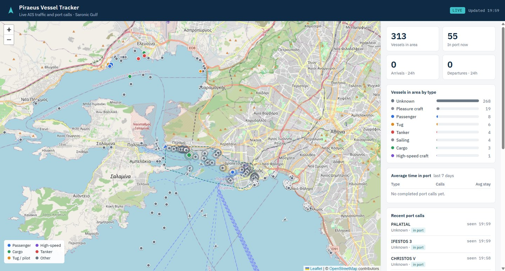

# Piraeus Vessel Tracker

Live vessel map and port-call statistics for the **Port of Piraeus**, built on public AIS data.

The app streams AIS messages for the Saronic Gulf from [AISStream.io](https://aisstream.io),
stores positions and vessel details, detects when ships arrive at and leave the port, and shows
everything on a live map with a statistics panel.



- **Live map**: every vessel in the area with its type, speed, course and destination; click a
  vessel to see its track for the last 6 hours.
- **Port-call detection**: a call starts when a vessel stops inside the port area and ends when
  it leaves. Vessels already berthed when first seen count as in port but not as arrivals, so
  arrival counts and times in port stay honest. Open calls survive restarts.
- **Statistics**: arrivals and departures in the last 24 hours, vessels in port, vessel mix by
  type, and average time in port per ship type over the last 7 days.
- **Demo mode**: a built-in simulator (ferries to Aegina, container ships, a cruise ship, a
  ro-ro, a tanker at anchor, harbour craft) so the app runs without an API key.

## Tech

- **Node.js 22**, no external npm dependencies: built-in `WebSocket` client, `node:sqlite`
  storage and `node:http` server
- **SQLite** with WAL mode; schema for vessels, track points and port calls
- **Leaflet** map (bundled), vanilla JavaScript front end
- **node:test** test suite and GitHub Actions CI

## Getting started

Requires Node.js 22.13 or later.

```bash
git clone https://github.com/Chatzo7/piraeus-vessel-tracker.git
cd piraeus-vessel-tracker

# Run with simulated vessels (no API key needed)
npm run demo
# open http://localhost:3000
```

To use real AIS data, create a free API key at [aisstream.io](https://aisstream.io), then:

```bash
cp .env.example .env      # and put your key in AISSTREAM_API_KEY
npm start
```

Run the tests with `npm test`.

## How it works

```
AISStream (WebSocket) ─► normalise ─► SQLite ─► HTTP API ─► Leaflet map
                              │
                              └─► port-call detector (geofence + speed)
```

| File | Role |
| --- | --- |
| `src/aisstream.js` | WebSocket client with subscription and automatic reconnect |
| `src/ais.js` | Turns raw AIS messages into clean records (validation, ship-type categories) |
| `src/portcalls.js` | Port-call state machine: berthed inside the port polygon → arrival; outside → departure |
| `src/store.js` | SQLite schema, writes, live/track/statistics queries |
| `src/server.js` | JSON API and static files |
| `src/demo.js` | Simulated fleet that emits AISStream-format messages |
| `public/` | Map and statistics panel |

### API

| Endpoint | Returns |
| --- | --- |
| `GET /api/vessels` | Vessels heard from in the last 30 minutes |
| `GET /api/vessels/{mmsi}/track?hours=6` | Track points for one vessel |
| `GET /api/stats` | Counts, vessel mix, average time in port, recent port calls |
| `GET /api/config` | Port polygon, streamed area, mode |
| `GET /api/health` | Message counters |

### Design choices

- One track point per vessel per minute keeps storage small; track points older than 7 days are
  pruned hourly.
- Tugs, pilot boats, fishing and leisure craft are shown on the map but left out of port-call
  statistics, because they move around the port all day.
- Port calls shorter than 10 minutes are ignored in the average-stay figures.
- The port polygon and the streamed area are in `src/config.js` and can be adjusted.

## Deploying to Azure

See [docs/azure.md](docs/azure.md) for running it on Azure App Service.

## Data and limitations

AIS data is broadcast by the vessels themselves and relayed by a volunteer receiver network, so
coverage, names and destinations can be incomplete or wrong. The port area is an approximation.
This is a personal project for learning and demonstration; it is not suitable for navigation or
operational use.

## License

MIT. Leaflet is included under its BSD 2-Clause licence (`public/vendor/leaflet/LICENSE`).
